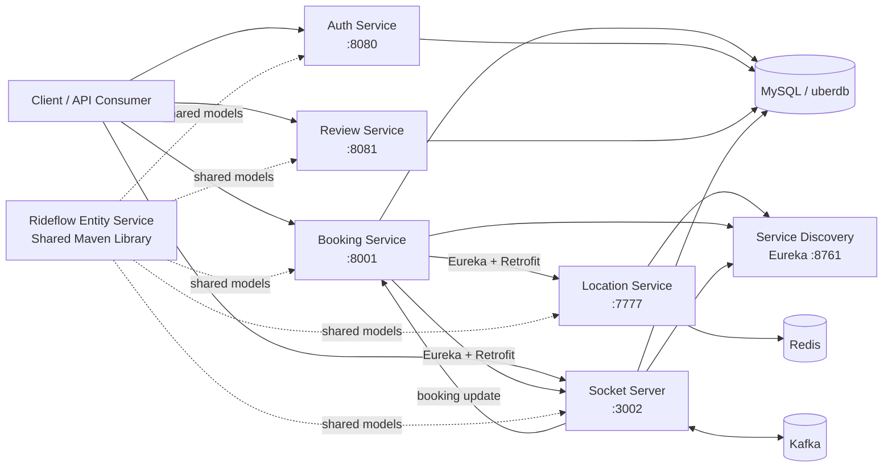

# RideFlow

RideFlow is a Java/Spring Boot ride-hailing backend built as a collection of independently deployable services. The project explores service discovery, authentication, geospatial driver lookup, booking orchestration, real-time driver notifications, Kafka messaging, JPA persistence, and a shared domain-model library.

This repository is the **umbrella / navigation repository** for the platform. The application source code lives in separate GitHub repositories so each service can be built, tested, and evolved independently.

## Architecture



> **Current-code note:** Location Service, Booking Service, and Socket Server are Eureka clients. Auth Service and Review Service do not currently register with Eureka.

## Repositories

| Component | Repository | Port | Main responsibility |
|---|---|---:|---|
| Umbrella | [RideFlow](https://github.com/Abhilash-Panja/RideFlow) | — | Project overview and navigation |
| Service Discovery | [Service-Discovery](https://github.com/Abhilash-Panja/Service-Discovery) | 8761 | Netflix Eureka service registry |
| Authentication | [RideFlow-AuthService](https://github.com/Abhilash-Panja/RideFlow-AuthService) | 8080 | Passenger signup/login, JWT creation and validation |
| Shared Domain Library | [Rideflow-EntityService](https://github.com/Abhilash-Panja/Rideflow-EntityService) | — | Shared JPA entities, enums and database model |
| Location | [Location-Service](https://github.com/Abhilash-Panja/Location-Service) | 7777 | Store driver coordinates and find nearby drivers through Redis GEO |
| Booking | [Booking-Service](https://github.com/Abhilash-Panja/Booking-Service) | 8001 | Create bookings and orchestrate driver discovery/assignment |
| Review | [ReviewService](https://github.com/Abhilash-Panja/ReviewService) | 8081 | Passenger/driver CRUD, booking-state workflow and post-ride reviews |
| Real-time Socket | [Socket-Server](https://github.com/Abhilash-Panja/Socket-Server) | 3002 | STOMP/WebSocket ride notifications and driver responses |

## Core Distributed Booking Flow

The most important cross-service flow currently implemented is:

```text
Passenger/API
    |
    | POST /api/v1/booking
    v
Booking Service
    |
    | creates booking with ASSIGNING_DRIVER
    |
    | POST /api/location/nearby/drivers
    | service resolved from Eureka
    v
Location Service
    |
    | Redis GEO search (5 km radius)
    v
Booking Service
    |
    | POST /api/socket/newride
    | service resolved from Eureka
    v
Socket Server
    |
    | broadcasts /topic/rideRequest
    v
Connected Drivers
    |
    | STOMP -> /app/rideResponse/{userId}
    v
Socket Server
    |
    | POST Booking Service update
    v
Booking becomes SCHEDULED with selected driver
```

The **Review Service** currently implements a separate local booking/review workflow using direct JPA access. It does not call Location Service, Socket Server, Redis, or Kafka during its booking workflow.

## Technology Stack

- **Java:** 17
- **Framework:** Spring Boot 4.x
- **Service discovery:** Spring Cloud Netflix Eureka
- **Security:** Spring Security + JWT
- **Persistence:** Spring Data JPA / Hibernate
- **Database:** MySQL
- **Geospatial location:** Redis GEO
- **Messaging:** Apache Kafka
- **Real-time communication:** Spring WebSocket + STOMP + SockJS
- **Inter-service HTTP:** Retrofit / OkHttp
- **API documentation:** Springdoc OpenAPI in Review Service
- **Build:** Gradle
- **Shared contracts:** Versioned `Rideflow-EntityService` Maven artifact

## Prerequisites

Install or have access to:

- JDK 17+
- MySQL 8+
- Redis
- Apache Kafka
- Git

Gradle does not need to be installed globally because each repository includes the Gradle Wrapper.

## Clone the Project

Create one workspace and clone the repositories as sibling directories:

```bash
mkdir RideFlow-Workspace
cd RideFlow-Workspace

git clone https://github.com/Abhilash-Panja/RideFlow.git
git clone https://github.com/Abhilash-Panja/Service-Discovery.git
git clone https://github.com/Abhilash-Panja/RideFlow-AuthService.git
git clone https://github.com/Abhilash-Panja/Rideflow-EntityService.git
git clone https://github.com/Abhilash-Panja/Location-Service.git
git clone https://github.com/Abhilash-Panja/Booking-Service.git
git clone https://github.com/Abhilash-Panja/ReviewService.git
git clone https://github.com/Abhilash-Panja/Socket-Server.git
```

## Important: Shared Entity Version Alignment

The services currently reference different snapshots of the shared entity library:

| Consumer | Current shared-model dependency |
|---|---|
| Auth Service | `0.0.7-SNAPSHOT` |
| Review Service | `0.0.7-SNAPSHOT` |
| Location Service | `0.0.7-SNAPSHOT` |
| Socket Server | `0.0.7-SNAPSHOT` |
| Booking Service | `0.0.7-SNAPSHOT` |
| Entity Service repo | `0.0.7-SNAPSHOT` |

On a clean machine, a service cannot resolve a historical snapshot unless that version is available in Maven Local or another configured Maven repository.

For a clean full-platform build, prefer to **align all consumers to one compatible EntityService version**. If you intentionally keep historical snapshots, publish each required version to Maven Local.

To publish the current EntityService version:

```bash
cd Rideflow-EntityService

# Linux/macOS
./gradlew publishToMavenLocal

# Windows
gradlew.bat publishToMavenLocal
```

## Local Infrastructure

### MySQL

Create the development database:

```sql
CREATE DATABASE uberdb;
```

Several services currently default to local development credentials in `application.properties`. Override them for your machine and never reuse checked-in development credentials in production.

Typical environment overrides:

```text
SPRING_DATASOURCE_URL=jdbc:mysql://localhost:3306/uberdb
SPRING_DATASOURCE_USERNAME=root
SPRING_DATASOURCE_PASSWORD=<your-password>
```

### Redis

Start Redis on the default:

```text
localhost:6379
```

Location Service uses Redis GEO operations to store driver coordinates and search for nearby drivers.

### Kafka

Start Kafka so the broker is reachable at:

```text
localhost:9092
```

Socket Server contains active Kafka producer/consumer wiring. Booking Service also contains Kafka configuration/dependencies.

## Recommended Startup Order

A practical order for the distributed booking flow is:

1. MySQL
2. Redis
3. Kafka
4. Publish the required `Rideflow-EntityService` artifact(s)
5. Service Discovery
6. Location Service
7. Socket Server
8. Booking Service
9. Auth Service
10. Review Service

Start a Spring Boot service with:

```bash
# Linux/macOS
./gradlew bootRun

# Windows
gradlew.bat bootRun
```

## Useful Local URLs

| Purpose | URL |
|---|---|
| Eureka Dashboard | `http://localhost:8761` |
| Auth API | `http://localhost:8080/api/v1/auth` |
| Location API | `http://localhost:7777/api/location` |
| Booking API | `http://localhost:8001/api/v1/booking` |
| Review API | `http://localhost:8081/api/v1` |
| Review Swagger UI | `http://localhost:8081/swagger-ui/index.html` |
| Review OpenAPI JSON | `http://localhost:8081/v3/api-docs` |
| Socket REST bridge | `http://localhost:3002/api/socket` |
| Socket SockJS/STOMP endpoint | `http://localhost:3002/ws` |

## Current Integration Notes

These points describe the checked-in implementation and are useful when debugging the full system:

- Booking Service resolves `LOCATIONSERVICE` and `SOCKETSERVER` through Eureka.
- Location Service performs the nearby-driver search using Redis GEO with a current radius of **5 km**.
- Socket Server exposes `/ws` with STOMP application prefix `/app` and broker destinations `/topic` and `/queue`.
- Socket Server currently calls Booking Service at `http://localhost:8001` when handling a driver response instead of resolving Booking Service through Eureka.
- Auth Service currently runs as a standalone HTTP service and does not include an Eureka client dependency.
- Review Service currently runs as a standalone HTTP/JPA workflow and does not participate in the distributed driver-dispatch flow.
- The umbrella repository currently contains documentation only; orchestration such as Docker Compose is not committed here.

## Repository Documentation

Each service repository should contain its own README with:

- responsibility and architecture
- runtime dependencies
- local configuration
- API or WebSocket contracts
- build/run commands
- service-to-service interactions
- current implementation notes

Use those service READMEs for detailed setup and this repository as the entry point for the whole platform.

## Future Improvements

Useful next steps for evolving RideFlow include:

- align the shared entity artifact version across every consumer
- route all service-to-service calls through discovery rather than hardcoded localhost URLs
- move secrets and database credentials fully out of source control
- add health checks and Spring Boot Actuator
- add OpenAPI documentation to REST-heavy services such as Auth, Location and Booking
- add automated integration tests for the distributed booking flow
- add Docker Compose or another local orchestration layer
- introduce an API Gateway for a single client-facing entry point
- improve Kafka event contracts and replace diagnostic/sample topics with domain events
- add observability with centralized logs, metrics and tracing

---

Built as a backend/microservices learning project around a realistic ride-hailing domain.
