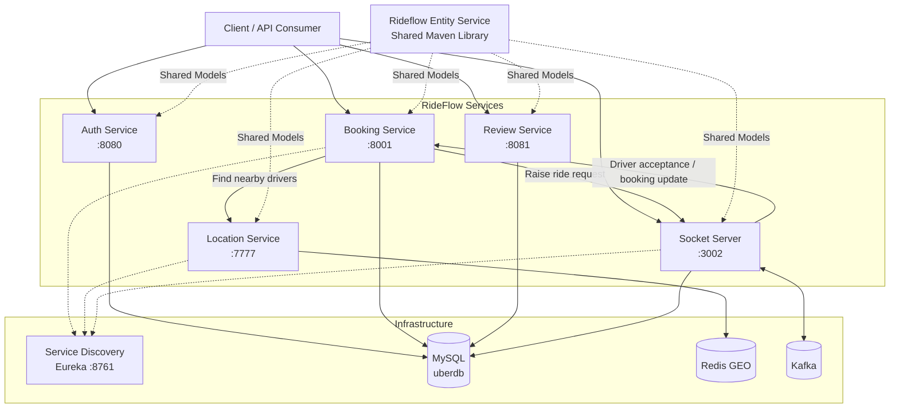
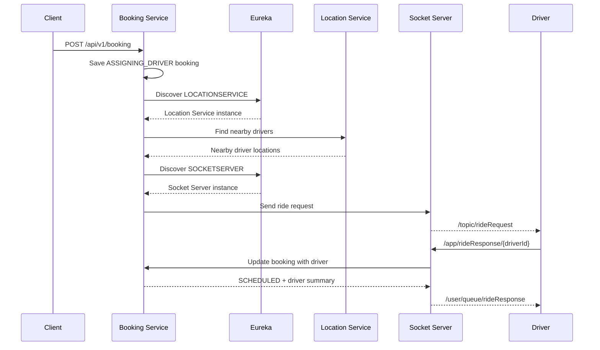

# RideFlow

RideFlow is a Java/Spring Boot ride-hailing backend built as a collection of independently deployable services. The project explores service discovery, authentication, geospatial driver lookup, booking orchestration, real-time driver notifications, Kafka messaging, JPA persistence, and a shared domain-model library.

This repository is the **umbrella / navigation repository** for the platform. The application source code lives in separate GitHub repositories so each service can be built, tested, and evolved independently.

---

## Architecture



---

## Distributed Booking Flow



> **Note:** Review Service contains a separate local booking/review workflow. Its booking flow does not currently call Location Service, Socket Server, Redis, or Kafka.

---

## Repositories

| Component           | Repository                                                                         |   Port | Responsibility                                   |
| ------------------- | ---------------------------------------------------------------------------------- | -----: | ------------------------------------------------ |
| Project Overview    | [RideFlow](https://github.com/Abhilash-Panja/RideFlow)                             |      — | Architecture and navigation                      |
| Service Discovery   | [Service-Discovery](https://github.com/Abhilash-Panja/Service-Discovery)           | `8761` | Netflix Eureka registry                          |
| Authentication      | [RideFlow-AuthService](https://github.com/Abhilash-Panja/RideFlow-AuthService)     | `8080` | Passenger signup, login and JWT authentication   |
| Shared Models       | [Rideflow-EntityService](https://github.com/Abhilash-Panja/Rideflow-EntityService) |      — | Shared JPA entities and enums                    |
| Location            | [Location-Service](https://github.com/Abhilash-Panja/Location-Service)             | `7777` | Driver location storage and nearby-driver search |
| Booking             | [Booking-Service](https://github.com/Abhilash-Panja/Booking-Service)               | `8001` | Distributed booking orchestration                |
| Review              | [ReviewService](https://github.com/Abhilash-Panja/ReviewService)                   | `8081` | CRUD, booking lifecycle and reviews              |
| Real-Time Messaging | [Socket-Server](https://github.com/Abhilash-Panja/Socket-Server)                   | `3002` | WebSocket/STOMP ride communication               |

---

## Technology Stack

* Java 17
* Spring Boot 4.x
* Spring MVC
* Spring Security
* JWT
* Spring Data JPA
* Hibernate
* MySQL
* Redis GEO
* Apache Kafka
* Spring WebSocket
* STOMP
* SockJS
* Netflix Eureka
* Retrofit / OkHttp
* Springdoc OpenAPI
* Gradle

---

## Swagger / OpenAPI Documentation

Springdoc OpenAPI is currently configured in:

* Auth Service
* Booking Service
* Review Service
* Socket Server REST API

| Service | Swagger UI                              | OpenAPI JSON                        |
| ------- | --------------------------------------- | ----------------------------------- |
| Auth    | `http://localhost:8080/swagger-ui.html` | `http://localhost:8080/v3/api-docs` |
| Booking | `http://localhost:8001/swagger-ui.html` | `http://localhost:8001/v3/api-docs` |
| Review  | `http://localhost:8081/swagger-ui.html` | `http://localhost:8081/v3/api-docs` |
| Socket  | `http://localhost:3002/swagger-ui.html` | `http://localhost:3002/v3/api-docs` |

Springdoc may redirect:

```text
/swagger-ui.html
```

to:

```text
/swagger-ui/index.html
```

### Swagger Coverage

```text
Auth
/api/v1/auth/**

Booking
/api/v1/booking/**

Review
/api/v1/**

Socket
/api/socket/**
```

Location Service does not currently contain Springdoc/OpenAPI configuration.

Service Discovery uses the Eureka dashboard instead of Swagger.

Entity Service is a shared library and does not expose a business HTTP API.

---

## Shared Entity Library

The current EntityService artifact is:

```text
com.rideflow:Rideflow-EntityService:0.0.7-SNAPSHOT
```

Current consumers:

| Service          | EntityService version |
| ---------------- | --------------------- |
| Auth Service     | `0.0.7-SNAPSHOT`      |
| Booking Service  | `0.0.7-SNAPSHOT`      |
| Review Service   | `0.0.7-SNAPSHOT`      |
| Socket Server    | `0.0.7-SNAPSHOT`      |
| Location Service | `0.0.4-SNAPSHOT`      |

> Location Service currently remains on an older snapshot.

---

## Prerequisites

Install:

* JDK 17+
* MySQL 8+
* Redis
* Apache Kafka
* Git

Each repository contains the Gradle Wrapper, so Gradle does not need to be installed globally.

---

## Clone the Platform

```bash
mkdir RideFlow-Workspace
cd RideFlow-Workspace

git clone https://github.com/Abhilash-Panja/RideFlow.git
git clone https://github.com/Abhilash-Panja/Service-Discovery.git
git clone https://github.com/Abhilash-Panja/RideFlow-AuthService.git
git clone https://github.com/Abhilash-Panja/Rideflow-EntityService.git
git clone https://github.com/Abhilash-Panja/Location-Service.git
git clone https://github.com/Abhilash-Panja/Booking-Service.git
git clone https://github.com/Abhilash-Panja/ReviewService.git
git clone https://github.com/Abhilash-Panja/Socket-Server.git
```

---

## Publish EntityService

Several RideFlow repositories resolve EntityService through Maven Local.

```bash
cd Rideflow-EntityService
```

Linux/macOS:

```bash
./gradlew publishToMavenLocal
```

Windows:

```bash
gradlew.bat publishToMavenLocal
```

---

## Database Setup

Create:

```sql
CREATE DATABASE uberdb;
```

Typical local connection:

```text
jdbc:mysql://localhost:3306/uberdb
```

Production credentials should be supplied through environment variables or another external configuration mechanism.

---

## Redis

Location Service uses Redis GEO operations.

Typical local Redis address:

```text
localhost:6379
```

---

## Kafka

Socket Server and Booking Service contain Kafka configuration.

Typical broker:

```text
localhost:9092
```

---

## Recommended Startup Order

For the complete distributed booking flow:

```text
1. MySQL
2. Redis
3. Kafka
4. Publish EntityService
5. Service Discovery
6. Location Service
7. Socket Server
8. Booking Service
9. Auth Service
10. Review Service
```

---

## Running a Service

Linux/macOS:

```bash
./gradlew bootRun
```

Windows:

```bash
gradlew.bat bootRun
```

---

## Useful URLs

| Purpose            | URL                                     |
| ------------------ | --------------------------------------- |
| Eureka Dashboard   | `http://localhost:8761`                 |
| Auth API           | `http://localhost:8080/api/v1/auth`     |
| Auth Swagger       | `http://localhost:8080/swagger-ui.html` |
| Location API       | `http://localhost:7777/api/location`    |
| Booking API        | `http://localhost:8001/api/v1/booking`  |
| Booking Swagger    | `http://localhost:8001/swagger-ui.html` |
| Review API         | `http://localhost:8081/api/v1`          |
| Review Swagger     | `http://localhost:8081/swagger-ui.html` |
| Socket API         | `http://localhost:3002/api/socket`      |
| Socket Swagger     | `http://localhost:3002/swagger-ui.html` |
| WebSocket endpoint | `http://localhost:3002/ws`              |

---

## Suggested Testing Flow

### 1. Verify Eureka

Open:

```text
http://localhost:8761
```

Expected registered services:

```text
LOCATIONSERVICE
BOOKINGSERVICE
SOCKETSERVER
```

### 2. Authentication

Open:

```text
http://localhost:8080/swagger-ui.html
```

Test:

```text
POST /api/v1/auth/signUp
POST /api/v1/auth/login
GET /api/v1/auth/validate
```

### 3. Save Driver Location

Use:

```text
POST /api/location/drivers
```

### 4. Create Booking

Open:

```text
http://localhost:8001/swagger-ui.html
```

Execute:

```text
POST /api/v1/booking
```

An immediate `201 Created` means the booking was created and asynchronous dispatch was started.

It does **not** guarantee that a driver has already accepted the ride.

### 5. Real-Time Driver Communication

Drivers subscribe to:

```text
/topic/rideRequest
```

Driver response:

```text
/app/rideResponse/{driverId}
```

Driver receives acknowledgement at:

```text
/user/queue/rideResponse
```

### 6. Review Workflow

Open:

```text
http://localhost:8081/swagger-ui.html
```

Recommended order:

```text
Driver / Passenger
        ↓
Booking
        ↓
Booking Status
        ↓
Review
```

---

## Current Implementation Notes

* Booking Service discovers Location Service and Socket Server through Eureka.
* Location Service searches Redis GEO within a 5 km radius.
* Booking Service currently receives nearby-driver results but does not pass those driver IDs into the outgoing Socket request.
* Socket Server currently broadcasts ride requests to all `/topic/rideRequest` subscribers.
* Socket Server currently calls Booking Service using `localhost:8001` when processing driver responses.
* Auth and Review Service are not currently Eureka clients.
* Review Service has its own local JPA booking workflow and is separate from distributed driver dispatch.
* Several services share the same `uberdb` database.
* The project does not currently contain an API Gateway.

---

## Future Improvements

* align EntityService versions across all consumers
* add Swagger/OpenAPI to Location Service
* replace hardcoded Socket → Booking URL with Eureka discovery
* send ride requests only to nearby drivers
* externalize secrets and database credentials
* add Spring Boot Actuator
* add distributed integration tests
* introduce API Gateway
* add centralized logging
* add metrics and tracing
* move toward versioned DTO/event contracts between services

---

RideFlow is a backend/microservices learning project built around a realistic ride-hailing domain.


---

## Interview Guide

For a plain-English project explanation, demo flow, common interview questions, and a learning roadmap, see [INTERVIEW_GUIDE.md](./INTERVIEW_GUIDE.md).
